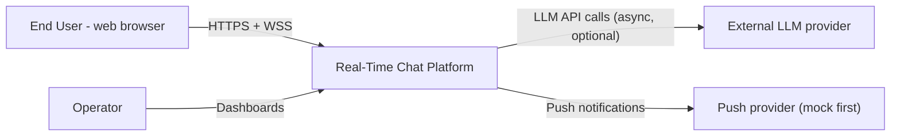
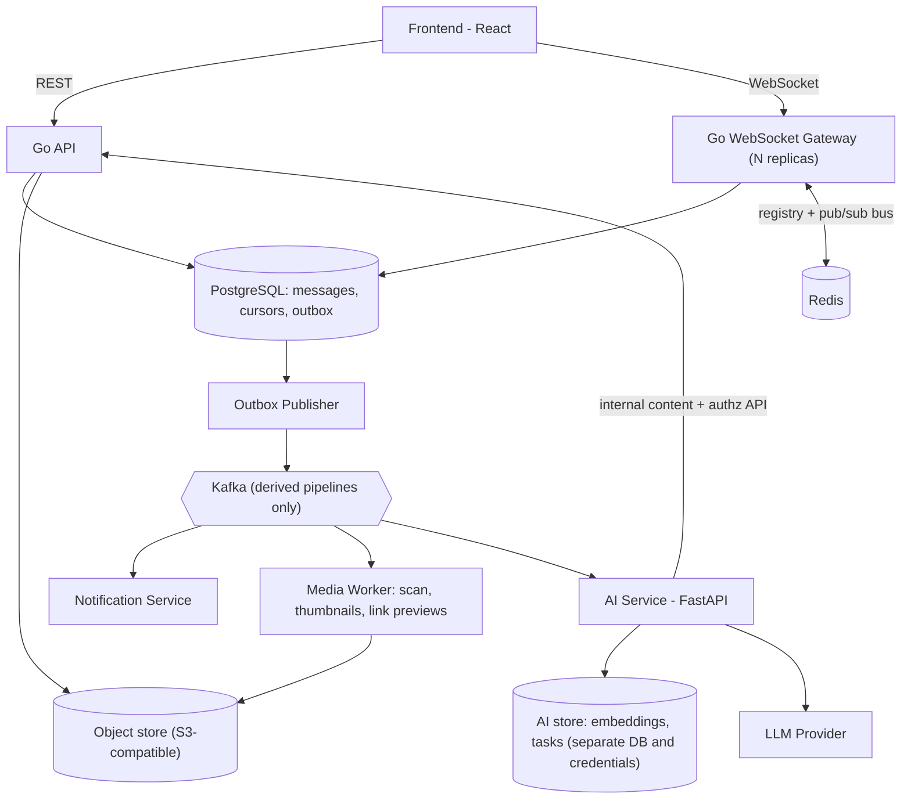
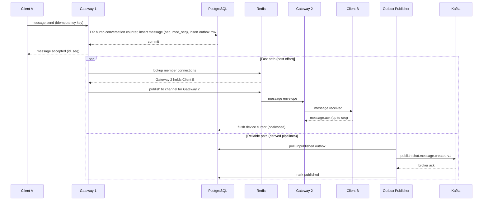
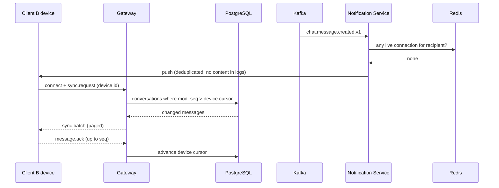
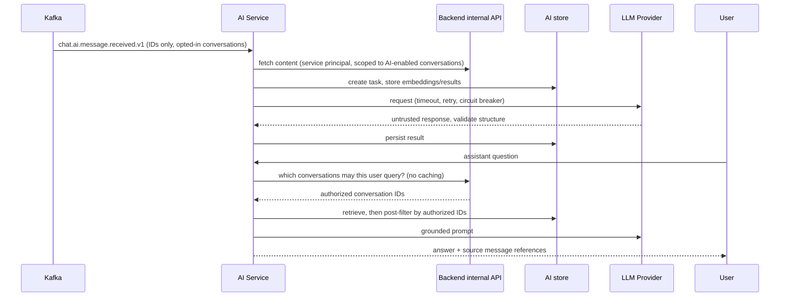
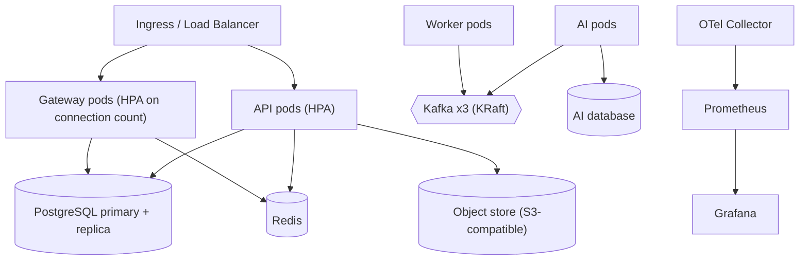

# High-Level Design (Revision 2)

Status: Draft for Phase 0 review. Diagrams describe the *intended* design, not an implementation.

Key changes from revision 1: Kafka removed from the online delivery path (ADR-005); sync is the correctness mechanism; receipts are cursors (ADR-007); concrete gateway routing (ADR-006); AI has its own data store (ADR-004); media processing is asynchronous.

## 1. System context

## 2. Containers

Online delivery between gateways uses Redis pub/sub, **not** Kafka.

## 3. Dependency criticality
| Component | Needed to accept a message | Needed for online delivery | Needed for correctness (eventual) |
|---|---|---|---|
| Gateway/API + PostgreSQL | Yes | Yes | Yes |
| Redis | No | Cross-gateway only (degrades to sync) | No |
| Outbox + Kafka | No | No | Only for derived features |
| Notification, Media, AI | No | No | No |

Initial deployables: `api`, `gateway`, `worker` roles from one Go codebase, plus `ai-service`. No further services until justified.

## 4. Message lifecycle: fast path and reliable path

If the fast path fails at any step, the recipient converges through sync (section 5). Duplicates are removed client-side by `(conversation_id, seq)`.

## 5. Reconnect, offline delivery and sync

Safety nets: clients detect sequence gaps and request gap-fill; clients run a periodic reconcile sync (assumed every 60 s while connected) to catch trailing lost pushes.

## 6. AI processing

## 7. Deployment architecture (target, Phase 8)

Deploy behavior: gateways drain connections gracefully (long termination grace period), clients reconnect with exponential backoff and jitter to avoid reconnect storms.

## 8. Ordering and delivery guarantees (see ADR-003, ADR-005)
- **Accepted:** committed in PostgreSQL. Not lost on single-node failure (for the tested durability configuration).
- **Display order:** `(conversation_id, seq)`, assigned inside the commit transaction, gapless, commit-ordered.
- **Change order for sync:** `mod_seq` from the same per-conversation counter (edits and deletes get a new `mod_seq`).
- **Kafka partitioning** by `conversation_id` gives consumers locality and per-conversation publish order, but is **not** the ordering authority.
- **Delivery to devices:** at-least-once, effectively-once after client dedupe.
- **Not guaranteed:** ordering across conversations; presence and typing are best-effort and ephemeral.

## 9. Presence and typing
Presence lives in Redis with TTL refreshed by heartbeats, plus a short grace period before declaring offline to avoid flapping. Clients subscribe to presence only for what is visible (open conversation, visible list items, capped), and groups above a size threshold show no presence. Typing indicators are ephemeral pub/sub only, rate-limited, never persisted.

## 10. Key risks
1. **Hot conversations:** the counter row lock serializes writers per conversation. Throughput per conversation is bounded by commit latency. Measure in Phase 3.
2. **Cursor write volume:** coalesce cursor flushes in the gateway; validate in Phase 4A.
3. **Redis pub/sub is fire-and-forget:** acceptable only because sync repairs losses; the reconcile interval bounds worst-case staleness.
4. **Outbox lag** affects derived features only; monitor it.
5. **AI authorization drift:** mitigated by no-cache query-time authorization plus post-filtering.
6. **Link previews and media fetches:** SSRF risk, handled in the media worker (Phase 5).
