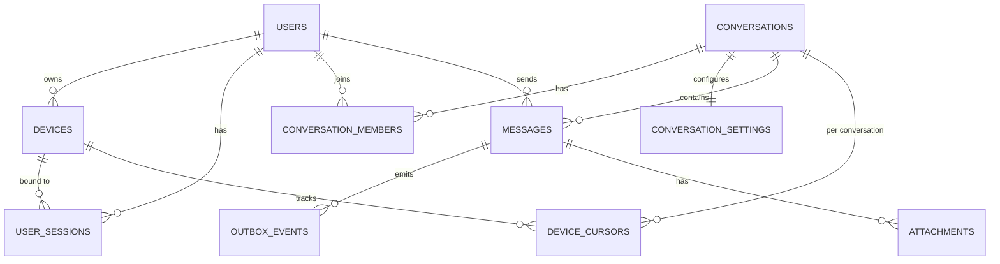

# Low-Level Design (Initial, Revision 2)

Status: Draft. Detailed schemas are finalized per phase and recorded in database-design.md, api-specification.md, and event-catalog.md. Changes must not be made silently.

## 1. Service interfaces (Go, conceptual)
```go
type MessageService interface {
    // One transaction: bump conversation counter, insert message (seq, mod_seq), insert outbox row.
    // Idempotent on (sender_device_id, idempotency_key).
    Accept(ctx context.Context, cmd SendMessage) (Message, error)
    History(ctx context.Context, userID, conversationID UUID, beforeSeq int64, limit int) (Page[Message], error)
    Edit(ctx context.Context, userID, messageID UUID, body string) (Message, error)   // new mod_seq
    Delete(ctx context.Context, userID, messageID UUID) error                         // tombstone, new mod_seq
}
type SyncService interface {
    // Conversations/messages with mod_seq greater than the device's cursor, paged.
    Sync(ctx context.Context, deviceID UUID, page SyncPage) (SyncBatch, error)
    AckDelivered(ctx context.Context, deviceID, conversationID UUID, upToSeq int64) error // coalesced
    MarkRead(ctx context.Context, userID, conversationID UUID, upToSeq int64) error
}
type AuthorizationService interface {
    CanAccessConversation(ctx context.Context, userID, conversationID UUID) error
    CanManageGroup(ctx context.Context, userID, conversationID UUID) error
}
type ConnectionRegistry interface { // Redis-backed, non-authoritative
    Register(ctx context.Context, c ConnInfo, ttl time.Duration) error
    Refresh(ctx context.Context, connID string, ttl time.Duration) error
    Lookup(ctx context.Context, userIDs []UUID) (map[UUID][]ConnInfo, error) // pipelined
    Remove(ctx context.Context, connID string) error
}
type GatewayBus interface { // Redis pub/sub today; swappable (ADR-006)
    PublishToGateway(ctx context.Context, gatewayID string, env Envelope) error
    Subscribe(ctx context.Context, gatewayID string, h func(Envelope)) error
}
```

## 2. Entities (draft)

Key columns (draft):
- `conversations(id, type, last_seq bigint)` where `last_seq` is the per-conversation counter.
- `messages(id, conversation_id, sender_id, sender_device_id, idempotency_key, seq, mod_seq, body, deleted_at, created_at)` with unique `(conversation_id, seq)`, unique `(sender_device_id, idempotency_key)`, and index `(conversation_id, mod_seq)` for sync.
- `device_cursors(device_id, conversation_id, delivered_seq, synced_mod_seq)` replaces per-message delivery rows.
- `conversation_members(conversation_id, user_id, role, read_seq, joined_at, removed_at)`.
- `outbox_events(id, topic, key, payload, created_at, published_at)`.

Conventions: UUID primary keys (v7 considered for locality, decide in ADR when implementing), `timestamptz`, soft delete for messages.

## 3. Sequence rules
- Counter bumped with `UPDATE conversations SET last_seq = last_seq + 1 WHERE id = $1 RETURNING last_seq` inside the message transaction. The row lock is held to commit, so `seq` is gapless and visible in commit order.
- New message: `seq = mod_seq = new counter value`.
- Edit or delete: bump the counter again, set only `mod_seq`. `seq` never changes (display order), `mod_seq` drives sync.

## 4. WebSocket protocol v1 (draft)
Envelope (both directions):
```json
{
  "v": 1,
  "type": "message.send",
  "event_id": "uuid",
  "request_id": "client-generated, echoed in responses",
  "ts": "RFC3339 timestamp",
  "payload": {}
}
```
Client events: `message.send`, `message.ack`, `typing.start`, `typing.stop`, `presence.update`, `conversation.join`, `conversation.leave`, plus additions in this revision: `sync.request`, `read.update`, `presence.subscribe`, `presence.unsubscribe`.
Server events: `message.accepted`, `message.received`, `message.delivered`, `message.read`, `typing.update`, `presence.changed`, `error`, plus `sync.batch` (revision addition).

Payloads (draft):
- `message.send`: `{ conversation_id, idempotency_key, body, attachment_ids }`
- `message.accepted`: `{ message_id, conversation_id, seq, idempotency_key, created_at }`
- `message.received`: full message envelope including `seq` and `mod_seq`
- `message.ack` (client): `{ conversation_id, up_to_seq }` meaning delivered up to this point
- `read.update` (client): `{ conversation_id, up_to_seq }`
- `sync.request`: `{ device_id, page_token? }`, `sync.batch`: `{ changes: [...], next_page_token? }`

Rules: auth at handshake; unsupported versions get `error: unsupported_version`; bounded outbound queue per connection, slow clients are disconnected; ping/pong with deadlines; clients dedupe by `(conversation_id, seq/mod_seq)`, detect gaps, and run periodic reconcile sync. Delivered and read updates are coalesced before broadcast.

## 5. Internal APIs (AI integration)
Service-to-service, mutually authenticated, never exposed publicly:
- `POST /internal/authz/conversations` : given `user_id`, returns conversation IDs that user may query and that are AI-enabled.
- `GET /internal/conversations/{id}/messages?after_seq=` : content for AI-enabled conversations only, service principal scoped by consent.

## 6. Error contract
REST (RFC 7807 style) and WS `error` events share codes:
```json
{ "code": "forbidden", "message": "Not a member of this conversation", "request_id": "...", "retryable": false }
```
Codes: `invalid_request`, `unauthenticated`, `forbidden`, `not_found`, `conflict`, `rate_limited`, `payload_too_large`, `unsupported_version`, `unavailable`, `internal`. Messages never include internals or message content. Unauthorized resource access returns `not_found` where existence should not leak.

## 7. Authentication model
- Argon2id password hashes.
- Access token: short-lived (target ~15 min), signed, carrying user ID, session ID, device ID.
- Refresh token: opaque, random, stored hashed, rotated on use; reuse of a rotated token revokes the session family.
- Revocation checked on refresh and WS handshake; long-lived WS connections re-validate on a schedule and on a revocation message via the registry.
- Authorization enforced server-side on every resource; client-supplied IDs never trusted.
- Phase 2 clarifications (ADR-009): the session id in tokens is the refresh-token **family id**; access tokens are HS256 JWTs with claims `sub`, `sid`, `did`; strangers and removed members get the same 404 as missing resources.

## 8. Event conventions (details in event-catalog.md)
Envelope: `event_id`, `event_type`, `schema_version`, `occurred_at`, `producer`, `conversation_id` (partition key), `payload`. Topics are `chat.<name>.v<N>`. Additive changes only within a version. Payloads carry IDs, not message bodies, wherever consumers can fetch authorized content themselves.
